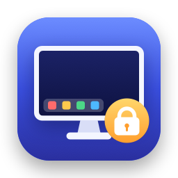

<p align="center">
  
</p>

<h1 align="center">LockDock</h1>

<p align="center">
  Keeps the macOS Dock on the display you choose.<br>
  No more Dock jumping to another monitor when the cursor touches its bottom edge.
</p>

<p align="center">
  <b>English</b> · <a href="#русский">Русский</a>
</p>

---

## Features

- Pick the display for the Dock from the menu bar
- Works with the Dock at the bottom, left or right
- Shared edges between monitors stay passable — only the outer Dock edge is guarded
- Pause with one click, launch at login, optionally hide the menu bar icon
- Tiny, free, open source, no network access

## Install

1. Download `LockDock-x.y.zip` from [Releases](../../releases) and move `LockDock.app` to **Applications**.
2. The app is not notarized, so macOS blocks the first launch. Either:
   - open it, then go to **System Settings → Privacy & Security** and click **Open Anyway**, or
   - run `xattr -dr com.apple.quarantine /Applications/LockDock.app` in Terminal.
3. Grant **Accessibility** access when asked (**System Settings → Privacy & Security → Accessibility**).
4. Click the menu bar icon and choose the display for the Dock.

Requires macOS 14.4 or later. Runs natively on Apple Silicon and Intel.

**Hidden the icon?** Open LockDock again from Finder, Spotlight or Launchpad — the icon comes back.

## How it works

macOS moves the Dock to a display when the cursor is pushed against that display's Dock edge.
LockDock watches mouse movement through an event tap and keeps the cursor 2 px away from that
edge on every display except the chosen one, so the Dock never gets the trigger. Nothing else
is touched — that's why it needs Accessibility access.

## Build from source

```bash
git clone https://github.com/<iamlykke>/LockDock.git
cd LockDock
./build.sh            # → build/LockDock.app
./build.sh --release  # → build/LockDock-<version>.zip
```

Only Xcode Command Line Tools are needed. The whole app is a single file:
[`Sources/main.swift`](Sources/main.swift).

---

## Русский

LockDock держит Dock на выбранном экране: он больше не перепрыгивает на другой монитор,
когда курсор упирается в нижний край.

### Возможности

- Выбор экрана для Dock из строки меню
- Работает с Dock снизу, слева и справа
- Общие края между мониторами остаются проходимыми — блокируется только внешний край
- Пауза в один клик, запуск при входе, можно скрыть значок в строке меню
- Маленькое, бесплатное, с открытым кодом, без доступа к сети

### Установка

1. Скачайте `LockDock-x.y.zip` из [Releases](../../releases) и перенесите `LockDock.app` в **Программы**.
2. Приложение не нотаризовано, поэтому macOS заблокирует первый запуск. Либо:
   - откройте его, затем **Системные настройки → Конфиденциальность и безопасность → Всё равно открыть**,
   - либо выполните в Терминале `xattr -dr com.apple.quarantine /Applications/LockDock.app`.
3. Дайте доступ в **Универсальный доступ**, когда macOS попросит.
4. Нажмите на значок в строке меню и выберите экран для Dock.

Нужна macOS 14.4 или новее. Работает на Apple Silicon и Intel.

**Скрыли значок?** Снова откройте LockDock через Finder, Spotlight или Launchpad — значок вернётся.

## License

[MIT](LICENSE)
